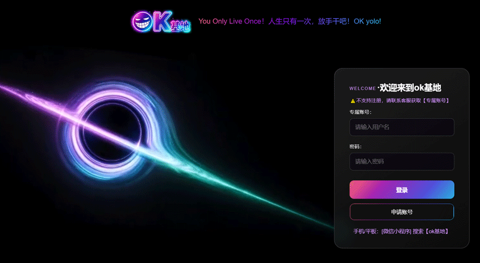

# OK基地-专用播放器（OKPlay）

OK基地课程**专用桌面播放器**，基于 Electron。

学员安装后打开客户端，客户端加载云端课程页面；学员在页面中输入课程专用账号和密码，即可点播课程章节、观看视频、查看课堂笔记，并浏览源码/模版、软件/工具、特效素材等资源库。

## 界面预览

| 登录 | 全部课程 |
|---|---|
|  |  |

| 源码 / 模版 | UI / 特效 / 素材 |
|---|---|
|  |  |


## 仓库内容

| 目录 | 内容 |
|---|---|
| `src/` + `package.json` | **Electron 客户端**（仓库根即客户端工程） |

**本仓库只包含桌面客户端。** 学员端页面源码、业务服务端与管理后台都不在仓库内 ——
客户端运行时加载的是云端页面 `https://learn.okyolo.com`，源码安装/打包都不需要它们。

## 安装

**Windows** —— 三种形式，都在 [Releases](https://github.com/okyolo/okplay/releases) 下载：

| 形式 | 文件 | 桌面图标 | 说明 |
|---|---|---|---|
| **安装版** | `OKPlay-<版本>-setup.exe` | **自动创建** | 双击即装，开始菜单 + 桌面快捷方式。**推荐** |
| **免安装版** | `OKPlay-<版本>-x64.zip` | 双击里面的 `创建桌面快捷方式.bat` | 解压即用，不写注册表 |
| **源码** | `Source code (zip)` | `npm run shortcut` | 见下方，需要 Node.js |

> ⚠️ **首次运行会被 SmartScreen 拦一下。** 这是**未签名**应用的正常提示，不是病毒 ——
> 点「更多信息」→「**仍要运行**」。原因与取舍见「已知限制」。
>
> 安装版是**装到用户目录**（`%LOCALAPPDATA%\Programs\OKPlay`）的，**不会弹 UAC**，
> 也不需要管理员权限。卸载时**保留**登录态与设备标识，重装不会被当成新设备。
>
> **免安装版没有安装器，所以不会自动建桌面图标** —— 双击解压目录里的
> `创建桌面快捷方式.bat` 即可补上。源码安装同理，跑 `npm run shortcut`。

**macOS** —— 只提供源码安装（见下方「源码安装」）。

### 源码安装（Windows / macOS）

前提：**Node.js LTS（≥20）** 与 **git**。

**Windows**

```bash
git clone https://github.com/okyolo/okplay.git
cd okplay
npm install
npm start            # 先跑一次，确认窗口能打开（这一步同时完成构建）
npm run shortcut     # 可选：在桌面建一个图标，以后双击就能开
```

**macOS**

```bash
git clone https://github.com/okyolo/okplay.git
cd okplay
npm install
npm start            # 先跑一次，确认窗口能打开（这一步同时完成构建）
npm run shortcut     # 可选：在桌面生成 OKPlay-源码安装.app
```

> `npm run shortcut` 每次会先跑 `npm run build`，所以单独先建图标也不会出现
> 「双击没反应」—— 但如果构建失败，它会直接报错退出。
>
> macOS 上没有「快捷方式」，`npm run shortcut` 会生成一个 `.app`：
> 图标取自 `src/assets/icon.png`，双击直接启动，日志在 `/tmp/okplay-start.log`
> （启动失败先看这个文件）。
> macOS 上如果首次运行提示「无法打开 Electron」，执行一次：
> `xattr -dr com.apple.quarantine node_modules/electron/dist/Electron.app`

> **国内网络提示**：`npm install` 需要下载约 100–150 MB 的 Electron 运行时。本仓库内置了镜像配置与兜底脚本（`scripts/ensure-electron.mjs`），安装时会自动处理。**不要删掉 `postinstall`。**

## 开发

**`npm start` 连的是生产** —— 源码安装就是给学员「装上就能用」的那条路。
要开发客户端（本机 Vite、开 devtools），用 **`npm run dev`**：

```bash
# 终端 1：起学员端页面
# ⚠️ web/ 不在本仓库里（学员端页面源码不公开分发）。
#    只有内部开发环境才有这个目录；外部克隆的仓库直接 `npm run dev` 会连不到页面。
cd web
npm install
npm run dev

# 终端 2：起客户端（--dev = 指向 http://localhost:5173 + 开 devtools）
npm run dev
```

> **判据只有 `--dev` 一个。** 早先这里按「没打包就算开发态」判断，结果源码安装
> 双击图标后指向 `localhost:5173`，学员机器上那里什么都没有 —— 表现是双击没反应。
> 现在打包版、源码安装都连生产，只有 `npm run dev` 走本机。

环境变量：

```bash
# 指到别处（预发、本机、任意地址）
OKPLAY_ORIGIN=https://<课程域名> npm start

# 页面连真实后端（默认 VITE_DEMO=1 走演示数据）
cd web && VITE_DEMO=0 npm run dev
```

检查（提交前）：

```bash
npm run verify    # 类型检查 + 安全基线静态断言
```

## 打包

```bash
npm run dist
```

产出在 `release/`：

- `OKPlay-<版本>-setup.exe` —— nsis 安装版
- `OKPlay-<版本>-x64.zip` —— 免安装版

配置见 `electron-builder.yml`。**只做 Windows** —— macOS 未签名/未公证的包在 Apple
Silicon 上会被报「已损坏」，所以 macOS 那条路走源码安装（理由见「已知限制」）。

> 首次打包会下载 electron-builder 的辅助二进制（nsis、winCodeSign）。国内网络若卡住，
> 设 `ELECTRON_BUILDER_BINARIES_MIRROR=https://registry.npmmirror.com/-/binary/electron-builder-binaries/`
> 后重跑。
>
> **课程域名是编译进产物的**（`src/shared/contracts.ts` 的 `PRODUCTION_ORIGIN`）。
> 安装版从开始菜单启动时读不到环境变量，只能靠它。

## 设计要点

- **客户端是薄壳**：加载云端课程页面，页面**不打包进客户端**。页面改版即时生效，无需更新客户端。
- **自带 Chromium**：播放环境不依赖用户电脑上安装的浏览器版本。
- **安全基线**：`contextIsolation` / `sandbox` / `webSecurity` 逐项显式设定，不依赖 Electron 默认值；远程页面在 preload 处的暴露面保持最小。
- **客户端内不做授权判定**：播放权限一律由服务端校验。
- **播放器自绘**：`<video>` + 自绘控制条 + hls.js。不用厂商播放器 SDK。
- **不使用 `<webview>`**；导航限定在自有域名；页面权限请求默认全拒。

## 已知限制

- **不提供代码签名与公证。** Windows 安装包首次运行会出现 SmartScreen 提示（「更多信息」→「仍要运行」）；macOS 因此只提供源码安装 —— 源码安装运行的是 Electron 官方已签名并公证的二进制，不受 Gatekeeper 影响。
- **不提供静默自动更新。** 客户端只做版本提示与更新入口。
- **国内下载 GitHub Releases 可能缓慢或失败。**

## 许可

<!-- 待补 -->
